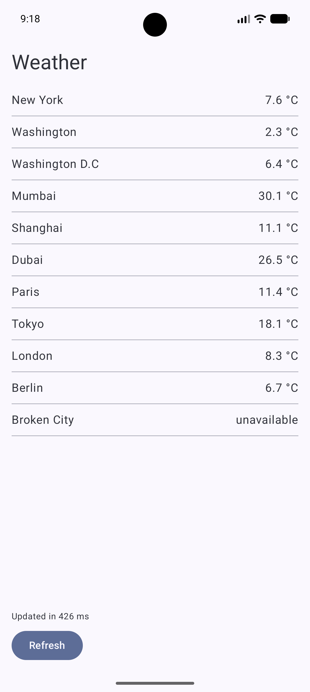

# CoroutineLabs

An Android app (Kotlin + Jetpack Compose) that loads the current weather for 10 cities and compares plain blocking code with Kotlin coroutines. Each stage changes how the loading works and measures the result with a simple timer, so the differences are real numbers and not just claims.

The final app loads all cities in parallel, shows each temperature, marks failed cities as unavailable, and has a Refresh button. Earlier versions of the loader (blocking, sequential coroutines, and so on) are in the git history, in the commits named Stage 1 to Stage 4.

## What this project shows

- Why blocking network calls break on Android's main thread
- How coroutines (`suspend`, `viewModelScope`, dispatchers) fix that
- How parallel loading with `async` / `awaitAll` changes the load time
- How to handle errors, timeouts, retries and cancellation in coroutines

## Setup

- Weather data: [Open-Meteo](https://open-meteo.com/) (free, no API key)
- Test device: Pixel 9 Pro emulator, API 37
- Measuring: a small `logTime` helper prints how long a block of code took to Logcat (tag `CoroutineLabs`)
- Numbers are averages of several runs on the emulator, so they vary a little from run to run

## Results

| Stage | Approach | Time for 10 cities | Notes |
|---|---|---|---|
| 1 | Blocking calls, one after another, in a plain `Thread` | ~385 ms (avg of 5 runs) | Crashes on the main thread |
| 2 | Coroutines (`suspend` + `Dispatchers.IO`), sequential | ~475 ms (avg of 5 runs) | Not faster than Stage 1: cities still load one by one, plus a small cost for switching threads |
| 3 | Coroutines, parallel (`async` + `awaitAll`) | ~196 ms (avg of 5 runs) | About 2.4x faster than sequential coroutines |
| 4 | Parallel + error handling (`supervisorScope`), 1 deliberately broken city | ~243 ms (avg of 5 runs, median 206 ms) | Good cities all load, the broken one is reported as failed |
| 5 | Parallel + per-request timeout (`withTimeoutOrNull`), with a simulated 10 s "Slow City" | 3005 ms (vs 10039 ms without the timeout) | Slow request is cancelled after 3 s and shown as unavailable |
| 6 | Cancellation (`Job.cancel()` on Refresh) | 3 taps: 3 loads finished before, 1 after | Old loads are cancelled instead of running to the end |

## Stages

### Stage 0: Setup
Compose project, `INTERNET` permission, and the `logTime` helper. Tested it with a known 500 ms delay and it printed 501 ms.

### Stage 1: The naive loader
Loads each city with a blocking `URL(...).readText()` call in a `for` loop.
- On the main thread, Android throws `NetworkOnMainThreadException`, because a blocking call would freeze the screen.
- Moving the loop into a plain `Thread` fixes the crash, but the cities still load one after another.
- An error inside that thread (a failed connection) crashed the whole app, because nothing catches it.
- Baseline: about 385 ms for 10 cities.

### Stage 2: First coroutines
`fetchTemperature` became a `suspend` function that wraps the blocking call in `withContext(Dispatchers.IO)`, and the loop runs inside `lifecycleScope.launch`.
- The coroutine starts on the main thread and only the network call switches to the IO thread pool, so the main thread is never blocked.
- Result: about 475 ms for 10 cities. Similar to Stage 1 (the cities are still sequential), with a small overhead from switching threads.
- One request hung for ~30 seconds on a stale emulator connection and crashed the app, because there is no error handling or timeout yet (Stages 4 and 5).

### Stage 3: Parallel loading
Instead of waiting for each city before starting the next, every city gets its own `async` coroutine and `awaitAll()` collects the results.
- All 10 requests are in flight at the same time, so the total time is close to the slowest single request, not the sum of all of them.
- Result: about 196 ms for 10 cities, versus about 475 ms sequential (2.4x faster) and about 385 ms with the blocking version (2x faster).
- The speedup is smaller than 10x. Parallel requests each open their own connection, and the emulator network adds noise.

### Stage 4: Error handling
I added a deliberately broken city (latitude 999) to the list to see what one failing request does to the other ten.
- **Before:** with plain `async` + `awaitAll()`, the failure crashed the app and none of the 10 good cities were shown, because a failing child cancels its parent and siblings.
- **Fix 1:** a `try / catch` inside each `async`, so the error never leaves the coroutine that failed.
- **Fix 2:** `supervisorScope`, where a failing child does not cancel its siblings, and the error is only thrown when you `await()` that one result. Each city is then handled on its own.
- **Experiment:** swapping `supervisorScope` for `coroutineScope` (while keeping the `try / catch` around `await()`) crashed the app again. A `catch` around `await()` is not enough in a normal scope, because the failure also goes up to the parent.
- Result: all 10 good cities load, the broken one is reported as failed, and there is no crash. Time is about 243 ms, so error handling costs nothing noticeable.
- One run took 2036 ms because a single request was slow, which is the problem Stage 5 addresses.

### Stage 4.5: A real screen
I moved the loading code into a `WeatherViewModel` and built a small Compose screen on top of it.
- The loader is the best version so far: parallel `async` requests inside `supervisorScope`, with errors handled per city.
- It runs in `viewModelScope`, so rotating the screen no longer restarts the loading, unlike the earlier `lifecycleScope` version in `onCreate`.
- The screen state uses Compose's `mutableStateOf` (no Flow), so the list redraws on its own when the data arrives.

### Stage 5: Timeout
I added a "Slow City" that answers after 10 seconds (simulated with `delay`).
- **Before:** the whole screen waited 10039 ms, because the list is only published after every request finishes.
- **Fix:** `withTimeoutOrNull(3_000)` around each request. If it takes longer, it is cancelled, returns `null`, and the city shows as unavailable.
- **Result:** 3005 ms, and every other city still shows its temperature.
- **Limit:** coroutine timeouts only work on cancellable code like `delay`. A blocking call such as `readText()` can't be interrupted this way, so a real connection timeout would have to be set on the connection itself (not done here).

### Stage 6: Cancellation
The Refresh button can now be tapped while a load is still running.
- **Before:** tapping Refresh 3 times quickly started 3 loads, and all 3 ran to the end (3 "load started", 3 "load finished"), making the same 12 requests three times.
- **Fix:** `launch` returns a `Job`. The ViewModel keeps it and calls `loadJob?.cancel()` at the start of every `refresh()`. Cancelling the parent also cancels all of its child `async` requests.
- **Result:** 3 "load started" but only 1 "load finished". The cancelled loads stop and never touch the screen state.
- **Gotcha:** cancellation is delivered as a `CancellationException`. A `catch (e: Exception)` would swallow it and break the cancellation, so the `catch` block rethrows it before handling real errors.
- Because the ViewModel uses `viewModelScope`, everything is also cancelled automatically when the ViewModel is discarded.

## Project structure

- `Cities.kt`: the list of cities with their coordinates
- `WeatherApi.kt`: `suspend` function that fetches the temperature for one city
- `WeatherViewModel.kt`: loads all cities in parallel and holds the screen state
- `WeatherScreen.kt`: the Compose screen
- `MainActivity.kt`: sets up the screen
- `Timing.kt`: the `logTime` helper used for the measurements in the stages above